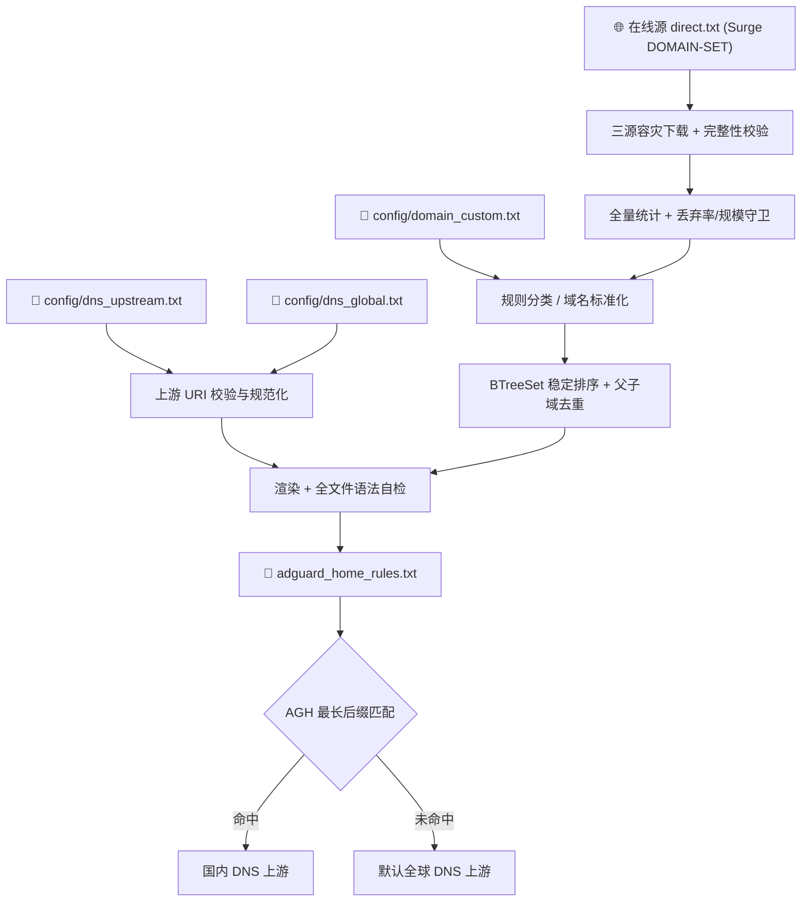

<div align="center">

# 🛡️ AdGuard Home DNS 分流规则编译工具

<p align="center">
  <strong>基于 Rust 打造的轻量、高性能国内外域名 DNS 分流规则清洗、聚合与自动化编译器</strong>
</p>

<p align="center">
  <a href="https://github.com/LianXia233/adguard-china-dns/releases/latest"></a>
  <a href="https://github.com/LianXia233/adguard-china-dns/actions/workflows/rust-release.yml"></a>
  <a href="Cargo.toml"></a>
  <a href="https://adguard.com/adguard-home.html"></a>
  <a href="LICENSE"></a>
</p>

<p align="center">
  <a href="#architecture">📊 架构设计</a> •
  <a href="#quick-start">🚀 快速上手</a> •
  <a href="#adguard-home">🔌 接入配置</a> •
  <a href="#semantics">🧬 规则语义</a> •
  <a href="#config">⚙️ 配置说明</a> •
  <a href="#verify">✅ 规则验证</a> •
  <a href="#faq">❓ 常见问题</a>
</p>

---

</div>

> [!TIP]
> 💡 **无需本地安装环境**：本项目通过 GitHub Actions **每日北京时间 07:23 自动构建并发布**最新规则文件。大多数用户只需直接下载 [Releases](https://github.com/LianXia233/adguard-china-dns/releases/latest) 中的 `adguard_home_rules.txt` 即可。

---

## 📖 背景与工作原理

AdGuard Home 本质上是一个 DNS 代理。本项目把「中国直连域名清单」编译成 AdGuard Home 原生支持的 `upstream_dns_file`（上游分流文件），实现：

| 查询类型 | 命中情况 | 使用的上游 |
| :--- | :--- | :--- |
| 国内域名 | 命中分流规则中的域名或其子域 | `config/dns_upstream.txt` 中的国内 DNS |
| 海外域名 / 未命中 | 未命中任何分流规则 | `config/dns_global.txt` 中的默认（全球）DNS |

关键机制（依据 [AdGuard Home 官方配置手册](https://adguard-dns.io/kb/adguard-home/configuration/)）：

- `upstream_dns_file` 一旦配置，**`dns.upstream_dns`（Web 界面里填的上游）会被整组忽略**，因此规则文件里必须自带裸上游行作为默认上游；
- `[/domain1/domain2/]upstream1 upstream2` 是 dnsmasq 风格语法：域名段用 `/` 分隔、以 `/]` 收尾，后面是**空格分隔**的多个上游；
- `[/example.com/]` 匹配 `example.com` **及其全部子域名**；`[/*.example.com/]` 只匹配子域名、不含根域名；
- 越具体的域名规则优先级越高；`#` 作为上游表示「改用默认上游」；空域名段 `//` 表示「仅无点裸主机名」（本项目禁止产生空段）；
- 该文件**启动时一次性读入**，没有热重载；任何一行语法错误都会让 DNS 服务直接 `[fatal]` 无法启动，不是「部分失效」。

产物结构：文件头部是统计与语义说明注释，接着是 1~2 行**裸默认上游**，之后是 `[/域名组/]国内上游列表` 规则行。

---

<a id="architecture"></a>
## 📊 工作流架构



引擎采用纯 Rust + `reqwest`（无正则引擎、无 Shell 依赖），域名校验、IDN→Punycode、URI 规范化均为手写实现。

---

## ✨ 核心特性

- **稳定可复现**：域名用 `BTreeSet` 字典序排序后分组合块，产物不受 `HashSet` 随机迭代顺序影响；同一份输入两次编译的规则部分逐字节一致。
- **规则语义可审计**：区分 Surge DOMAIN-SET 的「精确匹配」与「后缀匹配」，对无法无损转换的精确匹配规则采用**后缀匹配优先**策略统一转为后缀匹配，并显式输出数量、策略与样本（见 [规则语义](#semantics)）。
- **全量数据统计**：原始行数、有效记录、解析/转换数、唯一域名、重复、无效、不支持、丢弃、父子域去重、Punycode 数均写入产物头部注释与 `--report-json`。
- **严格下载校验**：状态码 → Content-Type → 压缩/二进制魔数 → UTF-8 → HTML 错误页 → 行数 → 域名行占比，任一失败换源；彻底失败不写产物。
- **上游 URI 严格校验**：协议白名单、主机/IPv6/端口、DoH 路径；只规范化 scheme 与主机名，**保留 URL 路径与 DNS Stamp 的大小写**。
- **三层兼容性门禁**：静态语法校验器 → 官方 dnsproxy v0.86.0 解析 → 真实 AdGuard Home v0.107.80 启动加载。
- **零运行时系统依赖**：单一静态二进制，跨平台。

---

<a id="quick-start"></a>
## 🚀 快速上手

### 方案 A：直接下载预编译规则（推荐）

```bash
wget -O /opt/adguardhome/conf/adguard_home_rules.txt \
  https://github.com/LianXia233/adguard-china-dns/releases/latest/download/adguard_home_rules.txt
```

### 方案 B：定时自动更新

```bash
# 每日凌晨 03:30 拉取并重启容器
30 3 * * * wget -qO /opt/adguardhome/conf/adguard_home_rules.txt https://github.com/LianXia233/adguard-china-dns/releases/latest/download/adguard_home_rules.txt && docker restart adguardhome > /dev/null 2>&1
```

### 方案 C：本地源码编译

```bash
git clone https://github.com/LianXia233/adguard-china-dns.git
cd adguard-china-dns
cargo build --release
sudo cp target/release/adguard-china-dns /usr/local/bin/
```

首次运行时若 `config/` 不存在会自动生成默认模板。

#### 命令行参数

| 参数 | 说明 |
| :--- | :--- |
| `-o, --output <路径>` | 输出规则文件（默认 `OUTPUT_FILE` 环境变量，或系统临时目录） |
| `-c, --config-dir <目录>` | 配置文件目录（默认 `CONFIG_DIR` 环境变量，或可执行文件同级 `config/`） |
| `--rules-file <路径>` | 使用本地规则文件代替在线下载，便于离线复现与测试 |
| `--exact-match-policy <expand\|skip>` | 精确匹配规则策略，默认 `expand`（后缀匹配优先，统一转为后缀匹配并显式记录）；`skip` 为跳过并统计 |
| `--min-domains <数量>` | 清洗后最低域名数守卫，默认 50000，测试时可设 0 |
| `--report-json <路径>` | 额外输出结构化统计 JSON |
| `-V` / `-h` | 版本 / 帮助 |

优先级：**CLI 参数 > 环境变量 > 默认值**。

---

<a id="adguard-home"></a>
## 🔌 接入 AdGuard Home

### 版本要求

本产物使用的「单行多上游 + 多域名合组」语法，已在 **AdGuard Home v0.107.80（依赖 dnsproxy v0.86.0）** 上由源码与真实二进制双重确认：

- dnsproxy `proxy/upstreams.go` 的 `splitConfigLine` 用 `strings.Fields(upstreamsLine)` 解析一行内的多个上游；
- 域名由 `netutil.ValidateDomainName`（golibs）校验，先做 `idna.ToASCII`，再校验总长 ≤253、单 label ≤63、TLD 不得全为数字。

更早版本（含旧文档提到的 v0.107.41）未逐一实测，**建议直接升级到 v0.107.80 或更高**。

### 步骤 1：修改 `AdGuardHome.yaml`

```yaml
dns:
  upstream_dns_file: /opt/adguardhome/conf/adguard_home_rules.txt

  # 域名形式的 DoH/DoT 上游需要 Bootstrap 解析其主机名
  # 8 个 Bootstrap 均经三轮 A/AAAA 实测可用，按服务商分散故障域：
  # 223.5.5.5 阿里 / 119.29.29.29 DNSPod / 114.114.114.114 114DNS /
  # 180.76.76.76 百度 / 1.2.4.8 CNNIC / 123.125.81.6 联通 /
  # 1.1.1.1 Cloudflare（兜底）/ 9.9.9.9 Quad9（兜底）
  bootstrap_dns:
    - 223.5.5.5
    - 119.29.29.29
    - 114.114.114.114
    - 180.76.76.76
    - 1.2.4.8
    - 123.125.81.6
    - 1.1.1.1
    - 9.9.9.9

  # 可选：load_balance（默认）/ parallel / fastest_addr，见下方说明
  upstream_mode: load_balance
```

> [!IMPORTANT]
> - **`--check-config` 拦不住坏规则**：实测把含 `[/a.com/b.com]/1.1.1.1` 的错误文件交给 `AdGuardHome --check-config`，返回码仍为 0 且打印 `configuration file is ok`。它不解析 `upstream_dns_file` 内容，只有真正启动 DNS 服务才会解析。发布前必须用本项目的三层校验。
> - **语法错误 = DNS 完全不可用**：只要一行不合法，日志出现 `wrong upstream format` 并 `[fatal]`，DNS 端口根本不监听。
> - **`upstream_dns_file` 非空时 Web 界面的上游设置不生效**。
> - **无热重载**：改完文件必须 `systemctl restart AdGuardHome` / `docker restart adguardhome`，或在 Web 界面保存一次配置。
> - **私有反向 DNS**：`192.168.x.x` 等私有地址的 PTR 查询应配置在 `local_ptr_upstreams` / Web 界面「Private reverse DNS servers」字段，**不要**写进本项目的公共分流规则文件（主字段里的私有 rDNS 规则不生效）。本产物不含任何 rDNS 规则。

> [!WARNING]
> Docker 部署时 `upstream_dns_file` 必须填**容器内路径**（例如 `-v /data/adg:/opt/adguardhome/conf` 时填 `/opt/adguardhome/conf/adguard_home_rules.txt`）。

### 步骤 2：重启服务并验证

```bash
sudo systemctl restart AdGuardHome   # 或 docker restart adguardhome
```

在 Web 控制台「查询日志」中确认：国内域名（如 `baidu.com`）显示 `dns_upstream.txt` 里的国内上游；海外域名（如 `github.com`）显示 `dns_global.txt` 里的默认上游。

---

<a id="semantics"></a>
## 🧬 域名转换规则与语义（重要）

在线源 [Loyalsoldier/surge-rules `release/direct.txt`](https://github.com/Loyalsoldier/surge-rules) 是 **Surge DOMAIN-SET** 格式。依据 [Surge 官方手册](https://manual.nssurge.com/rules/domain.html)：

> A plain line matches the hostname exactly, like a DOMAIN rule.
> A line starting with `.` matches the domain itself and all subdomains, like a DOMAIN-SUFFIX rule.

当前全量数据（2026-11-11 实测）为 **110,188 行**：

| 源规则类型 | 数量 | 源语义 | AdGuard Home 目标语义 | 转换结论 |
| :--- | ---: | :--- | :--- | :--- |
| `.example.com`（前导点） | 109,629 | 域名本身 + 全部子域 | `[/example.com/]` = 域名本身 + 全部子域 | **无损转换** |
| `example.com`（不带点） | 559 | **精确匹配该主机名** | `[/example.com/]` = 域名本身 + 全部子域 | **后缀匹配优先**：统一扩大为后缀匹配 |
| `*.example.com` | 0（本源无） | 仅子域 | `[/*.example.com/]` | 可无损表达 |
| `DOMAIN-KEYWORD` / `IP-CIDR` 等 | 0（本源无） | 关键字 / IP 段 | 上游文件无对应语义 | 不支持，跳过并统计 |

> [!IMPORTANT]
> **项目策略：后缀匹配优先。** AdGuard Home 的 `upstream_dns_file` 没有「精确匹配」语法，因此 559 条精确匹配规则（在线）+ 自定义文件中的精确匹配写法，默认 `--exact-match-policy expand` 统一**转为后缀匹配**，额外覆盖其子域名。这是主动选择的覆盖面优先策略，不是无损转换，也不是静默丢弃：编译器会在 stdout、产物头部注释和 `--report-json` 中输出数量、策略与代表性样本（如 `2mdn.net`、`a1.mzstatic.com`、`www.gstatic.com`）。
>
> `config/domain_custom.txt` 中所有域名已显式写成带前导点的后缀匹配形式，从源头消除语义歧义。
>
> 若你要求严格语义，可用 `--exact-match-policy skip` 跳过这些规则（同样会输出数量与样本）。注意**不能**用 `[/exact.com/]国内上游` + `[/*.exact.com/]#` 来模拟精确匹配：后者会把子域强制切回默认上游，从而覆盖父域的分流规则，反而改变语义。
>
> 其它无法表达的规则：`DOMAIN-KEYWORD`（子串匹配）、`DOMAIN-WILDCARD`（任意位置通配）、`IP-CIDR`/`GEOIP`。这些在 AdGuard Home 上游文件中没有等价物，应由过滤规则或路由层实现，本项目不会静默丢弃，而是分类统计并说明。

### 其它标准化行为

- 域名统一小写、去尾点、去前导点；支持 Unicode IDN → Punycode（手写 RFC 3492 Bootstring，含 Unicode 大小写折叠，如 `例子.中国` → `xn--fsqu00a.xn--fiqs8s`）；
- 校验对齐 golibs：总长 ≤253、单 label ≤63、label 非空且首尾不得为 `-`、TLD 不得全为数字（拦掉 `1.1.1.1` 这类 IP 字面量）；额外拒绝下划线、空格等无意义字符；
- 重复域名去重；**被父域名规则覆盖的子域名会去掉**（所有域名指向同一组上游，分流语义不变，实测去掉 165 条）；
- 支持 `DOMAIN,` / `DOMAIN-SUFFIX,` / `DOMAIN-KEYWORD,` 与 `domain:` / `domain-suffix:` / `domain-keyword:` 前缀，冒号/逗号后带空格亦能正确解析；
- 自定义域名文件同样按上述语义解释：**不带点 = 精确匹配（按默认策略扩大为后缀匹配），带前导点 = 后缀匹配**。项目默认配置文件已全部写成后缀匹配；若要让某个域名及其子域都走国内 DNS，请写成 `.example.com`。

---

<a id="config"></a>
## ⚙️ 配置文件说明 (`config/`)

每行一条，支持 `#` 注释与空行，CRLF 亦可。**上游条目会被严格校验**（协议、主机、端口、DoH 路径），非法条目直接终止编译，不会静默忽略。

### 1. 全局 / 海外兜底 DNS (`config/dns_global.txt`)

裸上游行即默认上游，**必须至少保留一条**。

```text
# Cloudflare 1.1.1.1 官方 DoT：IP 直连免 Bootstrap，TLS 证书含 1.1.1.1 SAN
tls://1.1.1.1

# 以下为官方端点示例，请按你所在网络的实测结果决定是否启用。
# https://dns.google/dns-query                  # Google Public DNS 官方 DoH（需 Bootstrap）
# https://unfiltered.adguard-dns.com/dns-query  # AdGuard DNS 无过滤（dns.adguard-dns.com 是过滤版）
# https://doh.opendns.com/dns-query             # Cisco OpenDNS 官方 DoH
# https://cloudflare-dns.com/dns-query          # Cloudflare 官方 DoH（与 tls://1.1.1.1 同服务）
# 9.9.9.9                                      # Quad9 明文 UDP（跨境明文可能被劫持）
```

> **为什么只剩一条**：在中国大陆 / 北京腾讯云出口实测（2026-11-11），`https://dns.google/dns-query`、`https://doh.opendns.com/dns-query`、`https://cloudflare-dns.com/dns-query`、`https://unfiltered.adguard-dns.com/dns-query`、`tls://8.8.8.8`、`tls://9.9.9.9`、`tls://94.140.14.140` 等海外加密端点全部连接重置或超时。`load_balance` 下混入不可达上游会让部分查询**等到 10s 超时**才切换——真实 AGH 实测中曾导致 `github.com` 解析失败。因此默认只启用实测可用的 `tls://1.1.1.1`，其余作为注释示例由你按网络环境启用。
>
> **AdGuard DNS 过滤版陷阱**：`dns.adguard-dns.com` / `94.140.14.14` 是**默认过滤服务器**（拦截广告、跟踪器、钓鱼），不是普通解析器；普通解析应使用 `unfiltered.adguard-dns.com` / `94.140.14.140`。旧配置里的 `quic://dns.adguard-dns.com` 已移除。

### 2. 国内加速 DNS (`config/dns_upstream.txt`)

**策略：全部使用加密 DNS（DoH / DoT），不启用任何明文 UDP 上游。** 9 条端点分属 3 家服务商，均经 2026-11-11 三轮 A/AAAA 实测（`rcode=0`、无超时、TLS 证书验证通过）。

```text
# --- 阿里云公共 DNS（官方 DoH / DoT；域名形式需 Bootstrap） ---
https://dns.alidns.com/dns-query
# 阿里云 IP 版 DoH：免 Bootstrap，同一服务，仅作接入冗余
https://223.5.5.5/dns-query
https://223.6.6.6/dns-query
tls://dns.alidns.com

# --- 腾讯云 DNSPod（官方 DoH / DoT；同一服务） ---
https://doh.pub/dns-query
tls://dot.pub

# --- 360 安全 DNS（官方 DoH / DoT；同一服务） ---
https://doh.360.cn/dns-query
https://120.53.53.53/dns-query
tls://dot.360.cn
```

| 服务商 | 端点 | 协议 | 平均 A RTT | 备注 |
| :--- | :--- | :--- | ---: | :--- |
| 阿里云 | `dns.alidns.com/dns-query` | DoH | 36 ms | 域名形式需 Bootstrap |
| 阿里云 | `223.5.5.5/dns-query` | IP 版 DoH | 33 ms | 免 Bootstrap |
| 阿里云 | `223.6.6.6/dns-query` | IP 版 DoH | 32 ms | 免 Bootstrap |
| 阿里云 | `dns.alidns.com` | DoT | 67 ms | 协议级冗余 |
| DNSPod | `doh.pub/dns-query` | DoH | 133 ms | 域名形式需 Bootstrap |
| DNSPod | `dot.pub` | DoT | 159 ms | 同一服务 |
| 360 | `doh.360.cn/dns-query` | DoH | 106 ms | 域名形式需 Bootstrap |
| 360 | `120.53.53.53/dns-query` | IP 版 DoH | 53 ms | 免 Bootstrap |
| 360 | `dot.360.cn` | DoT | 174 ms | 同一服务 |

变更说明：

- 按「国内加速 DNS 使用加密 DNS」要求，移除 `180.184.1.1` 与 `223.5.5.5` 两条**明文 UDP** 上游，全部替换为 DoH / DoT 端点；火山引擎 PublicDNS [官方 FAQ](https://volcengine.com/docs/TrafficRouteDNSSuite/FAQs-2?lang=zh) 明确仅支持 UDP/TCP 明文，不纳入；
- 候选端点参考 [dns.icoa.cn 国内](https://dns.icoa.cn/)、[海外](https://dns.icoa.cn/world/)、[教育网](https://dns.icoa.cn/edu/) 三页，最终以三轮实测结果为准；
- 实测发现 `1.12.12.12`、`120.53.53.53` 的**明文 UDP 不通但 DoH 可用**（只提供加密服务），因此 `120.53.53.53` 以 IP 版 DoH 纳入；`1.12.12.12` 因页面标注旧 IP 版 DoH 停用而暂不纳入；
- 教育网 `101.6.6.6:8443` DoH 与 OneDNS `doh-pure.onedns.net` 两轮均超时，未纳入；
- `tls://1.1.1.1` 属全球默认上游（853 通、443 的 DoH 不通），不属于国内加速组。

> 同一服务商的 DoH / DoT / 多 IP 入口**不是完全独立的冗余节点**，这里只是接入级冗余；`load_balance` 每次查询只选一条上游，不会因 9 条端点放大 9 倍请求，但混入不可达端点仍会拖慢故障切换，故只保留实测全通的端点。

### 3. 自定义直连域名 (`config/domain_custom.txt`)

后缀匹配优先：默认配置里所有域名都写成**带前导点**的形式，编译器输出 `[/域名/]`，匹配域名本身及全部子域。

```text
# 原有直连域名（统一改为后缀匹配）
.xoyo.com
.calatopia.com
.wegame.com.cn
.3gppnetwork.org
.ugreengroup.com

# 完美世界 / 异环
.wanmei.com
.perfectworld.com
# 原神
.mihoyo.com
.hoyoverse.com
.yuanshen.com
# 深空之眼
.ys4fun.com
.aethergazer.com
# 少女前线2：追放
.sunborngame.com
# 库洛游戏 / 鸣潮
.kurogames.com
# 明日方舟：终末地
.hypergryph.com
.skland.com
# 蓝色星原：旅谣
.manjuu.com
# 白银之城
.silverpalace.cn
.elementagames.com
# 无限大（只收 ananta 子域，不放大到整个 163.com）
.ananta.163.com
```

游戏域名均经官网 / 官方公告核实并验证可解析，一手来源包括：`yh.wanmei.com`（异环国服）、`nte.perfectworld.com`（异环国际服）、`ys.mihoyo.com`（原神国服）、`skzy.ys4fun.com`（深空之眼）、`gf2.sunborngame.com`（少女前线2）、`mc.kurogames.com`（鸣潮）、`endfield.hypergryph.com`（终末地）、`azurpromilia.manjuu.com`（蓝色星原）、`www.silverpalace.cn`（白银之城）、`ananta.163.com`（无限大）。`库洛游戏` 与 `鸣潮` 共用 `kurogames.com`，`完美世界` 与 `异环` 共用 `wanmei.com` / `perfectworld.com`，已合并去重。

> 保留的 3 个原有域名 `calatopia.com`、`3gppnetwork.org`、`ugreengroup.com` 在当前网络下解析失败，可能是内网 / 已停用域名；未擅自删除，请按需确认。

自定义域名逐行输出、优先级体现在「先写入且在线规则跳过同名域名」。注意所有域名最终都指向同一组国内上游，因此「优先级」只影响可读性，不会改变解析路径。

---

## 🔀 upstream_mode 说明

依据官方配置文档与 dnsproxy 源码，合法值只有三个（填错会 `[fatal] invalid upstream mode`）：

| `upstream_mode` | 实际行为 | 上游请求量 |
| :--- | :--- | :--- |
| `load_balance`（默认，留空即此值） | 按各上游历史失败次数与平均耗时加权随机挑一条；失败时才依次尝试其余上游 | 1×（失败才追加） |
| `parallel` | 并发向组内**所有**上游各发一次，取最先返回的成功响应 | N× |
| `fastest_addr` | 并发查询所有上游，再对**应答中返回的 IP 地址**做延迟探测，返回延迟最低的 IP（不是给上游打分） | N× + TCP 探测 |

> 「并发取最快响应」对应 `parallel`；`fastest_addr` 是对**解析结果 IP** 测速，且会产生额外探测流量。本产物每组 9 个国内上游，设为 `parallel` / `fastest_addr` 会让国内域名上游请求量放大 9 倍，公共 DoH 有速率限制风险。**默认 `load_balance` 是更稳妥的选择**。
>
> `load_balance` 遇到不可达上游会先等它超时才切换，所以组里混入「根本连不上」的上游会明显拖慢解析——这正是本项目精简上游清单的原因。

### Bootstrap DNS 与可达性

域名形式的加密上游（`dns.alidns.com`、`doh.pub`、`dot.pub`、`doh.360.cn`、`dot.360.cn`）必须先经 `bootstrap_dns` 解析主机名；IP 形式 DoH（`223.5.5.5`、`223.6.6.6`、`120.53.53.53`）与 IP 直连 DoT（`tls://1.1.1.1`）**不需要 Bootstrap**。

按「Bootstrap 多添加几个」的要求，示例已从 4 个扩充为 **8 个**，均经三轮 A/AAAA 实测可用，并按服务商分散故障域：

| Bootstrap | 服务商 | 平均 A RTT | 角色 |
| :--- | :--- | ---: | :--- |
| `223.5.5.5` | 阿里云 | 5.8 ms | 国内主用 |
| `119.29.29.29` | 腾讯云 DNSPod | 27.4 ms | 国内主用 |
| `114.114.114.114` | 114DNS | 24.0 ms | 国内备用 |
| `180.76.76.76` | 百度 | 11.6 ms | 国内备用 |
| `1.2.4.8` | CNNIC | 35.6 ms | 国内备用 |
| `123.125.81.6` | 联通 | 4.4 ms | 国内备用 |
| `1.1.1.1` | Cloudflare | 83.7 ms | 境外兜底 |
| `9.9.9.9` | Quad9 | 132.2 ms | 境外兜底 |

实测数据见 `output/dns_round1.json`、`output/dns_round2.json`、`output/dns_round3.json`（分别查询 `www.baidu.com`、`www.qq.com`、`github.com`）。三点注意：

- AdGuard Home 会并发向所有 `bootstrap_dns` 查询并取最快响应，因此多配几个不会线性放大延迟，但也不宜堆到十几个；
- 中国大陆网络下用国内 Bootstrap 解析境外 DNS 主机名存在被污染风险，故保留 2 个境外兜底；
- 明文 UDP 的 `1.12.12.12`、`120.53.53.53` 三轮均超时（只提供 DoH），**不要**写进 `bootstrap_dns`。

### IPv4 / IPv6、CNAME、DNSSEC

- 上游需同时能回答 A 与 AAAA；本项目的连通性测试分别记录两类查询；
- AdGuard Home 按**客户端查询的域名**选上游，CNAME 链上的目标域名不会重新触发分流（除非客户端再次发起查询）；
- 本项目不做 DNSSEC 校验，`upstream_dns_file` 只影响「发给谁」；DNSSEC 验证由客户端或上游解析器决定，使用过滤型/篡改型上游会破坏端到端完整性。

---

<a id="verify"></a>
## ✅ 规则验证方法（三层，缺一不可）

| 层级 | 命令 | 验证内容 |
| :--- | :--- | :--- |
| 1. 静态语法 | `python3 tools/validate_upstream_dns_file.py adguard_home_rules.txt` | 复刻 dnsproxy `splitConfigLine`：闭合符、空域名段、非法域名、上游 URI、默认上游、重复域名、父子域重叠 |
| 2. 官方源码解析 | `cd tools/agh_compat && go run . ../../adguard_home_rules.txt` | 用 AdGuard Home v0.107.80 依赖的 **dnsproxy v0.86.0** 真实解析：无 `wrong upstream format`、`UpstreamConfig.Validate()` 通过、默认上游存在、多上游生效、未命中域名回落 |
| 3. 真实运行时 | `python3 tools/agh_runtime_check.py --agh ./AdGuardHome --rules adguard_home_rules.txt` | 启动真实 AdGuard Home，确认进程存活、DNS 端口监听、日志无 fatal、实际 A/AAAA 查询成功 |

配套测试：

```bash
cargo fmt --check
cargo clippy --release --locked -- -D warnings
cargo test --release --locked
cargo build --release --locked
python3 tools/test_validate_upstream_dns_file.py     # 验证器 24 项单元测试
python3 tools/test_upstreams.py tools/endpoints.txt  # 上游连通性 / TLS 证书实测
```

> `tools/test_upstreams.py` 会记录测试时间、出口网络、协议、A/AAAA 结果、响应时间、超时与 TLS 证书验证情况。**它只代表当前运行环境**；若环境不在中国大陆，禁止把结果表述为中国大陆网络测试结果。

---

## 🤖 GitHub Actions 自动化流水线

- **触发**：每日 UTC 23:23（北京 07:23）；`src/**`、`Cargo.toml`、`Cargo.lock`、`config/**`、**`tools/**`**、`README.md`、`CHANGELOG.md`、`.github/workflows/**` 变更推送到 `main`；以及手动触发。
- **发布前门禁（任一失败即终止，不覆盖 `releases/latest`）**：`cargo fmt --check` → `clippy -D warnings` → `cargo test` → `cargo build --release --locked` → 验证器单元测试 → 上游配置检查 → 在线规则下载与生成 → 产物静态语法校验 → 域名规模校验（< 50000 终止）→ **官方 dnsproxy 解析校验** → **真实 AdGuard Home 加载校验**。
- **发布**：先创建新 Release 再清理旧版，只保留最新一份产物，`concurrency` 避免并发踩踏。

---

<a id="faq"></a>
## ❓ 常见问题与排查

<details>
<summary><strong>Q: AdGuard Home 启动报 <code>wrong upstream format</code> / <code>[fatal]</code>？</strong></summary>

> 说明 `upstream_dns_file` 里至少有一行不合 dnsproxy 语法。常见原因：写成了 `.../]/upstream`（正确是 `.../]upstream`）、出现空域名段 `//`、域名末级为纯数字、缺少 `/]` 收尾。
> 用 `python3 tools/validate_upstream_dns_file.py <文件>` 定位行号。注意 `--check-config` **不会**报这个错（实测含错误语法的文件仍返回 0）。

</details>

<details>
<summary><strong>Q: 报 <code>no default upstreams</code>？</strong></summary>

> `upstream_dns_file` 里没有裸上游行。请确保 `config/dns_global.txt` 至少有一条未注释的上游，且它出现在产物中（产物头部之后的第一段「全局基础 DNS」）。

</details>

<details>
<summary><strong>Q: 部分海外域名解析超时 / 很慢？</strong></summary>

> 多半是 `dns_global.txt` 里启用了当前网络不可达的海外 DoH/DoT。`load_balance` 会等待它超时才切换。用 `python3 tools/test_upstreams.py` 逐条实测，注释掉不可达项。中国大陆网络常见现象是海外 443/853 被封锁，此时需要配合代理或改用网络内可达的上游——本项目不解决网络可达性问题。

</details>

<details>
<summary><strong>Q: 规则文件只有两千多行，明明有十万多个域名？</strong></summary>

> 采用 `[/d1/d2/.../]upstream` 多域名合组，每 50 个域名共享同一份上游列表。实测 109,977 个域名 → 2,207 条规则行、约 1.67 MB，分流语义与逐行写法等价。

</details>

<details>
<summary><strong>Q: 修改规则文件后没有生效？</strong></summary>

> `upstream_dns_file` 无热重载，`AdGuardHome -s reload` 只刷新 ARP 表与 TLS 证书。请重启服务或在 Web 界面保存一次配置。

</details>

<details>
<summary><strong>Q: 为什么我的 <code>example.com</code> 自定义域名把子域名也带走了？</strong></summary>

> 见 [规则语义](#semantics)：AdGuard Home 无精确匹配语法，项目采用后缀匹配优先，不带点的写法默认统一转为后缀匹配。可用 `--exact-match-policy skip` 关闭该行为，或（推荐）改用 `.example.com` 显式表达后缀匹配。

</details>

---

## 📂 目录结构

```text
adguard-china-dns/
├── .github/workflows/rust-release.yml   # 自动构建与发布前质量门禁
├── config/
│   ├── dns_global.txt                  # 默认（全球）上游
│   ├── dns_upstream.txt                # 国内上游
│   └── domain_custom.txt               # 自定义直连域名
├── src/
│   ├── main.rs                         # CLI / 编译流程 / 统计 / 输出
│   ├── domain.rs                       # 规则分类、IDN→Punycode、校验、去重、统计
│   ├── download.rs                     # 多源下载与完整性校验
│   ├── upstream.rs                     # 上游 URI 校验与规范化
│   └── rules.rs                        # 规则渲染与发布前语法自检
├── tools/
│   ├── validate_upstream_dns_file.py   # 静态语法门禁
│   ├── test_validate_upstream_dns_file.py  # 验证器单元测试
│   ├── test_upstreams.py               # 上游连通性 / TLS 实测
│   ├── agh_runtime_check.py            # 真实 AdGuard Home 加载验证
│   └── agh_compat/                     # 官方 dnsproxy v0.86.0 解析校验（Go）
├── Cargo.toml / Cargo.lock
├── CHANGELOG.md / LICENSE / README.md
```

---

## 📜 数据来源与开源协议

- **规则数据源**：[Loyalsoldier/surge-rules](https://github.com/Loyalsoldier/surge-rules) `release/direct.txt`（Surge DOMAIN-SET 格式）。
- **上游资料来源**：各服务商官方文档（阿里云公共 DNS、DNSPod、360 安全 DNS、火山引擎 PublicDNS FAQ、Cloudflare 1.1.1.1、Google Public DNS、AdGuard DNS Known DNS Providers、Cisco OpenDNS）与 AdGuard Home / dnsproxy 官方源码。
- **开源协议**：本项目核心编译引擎采用 [GPL-3.0](LICENSE)；各上游域名数据资产版权归原维护者所有。
