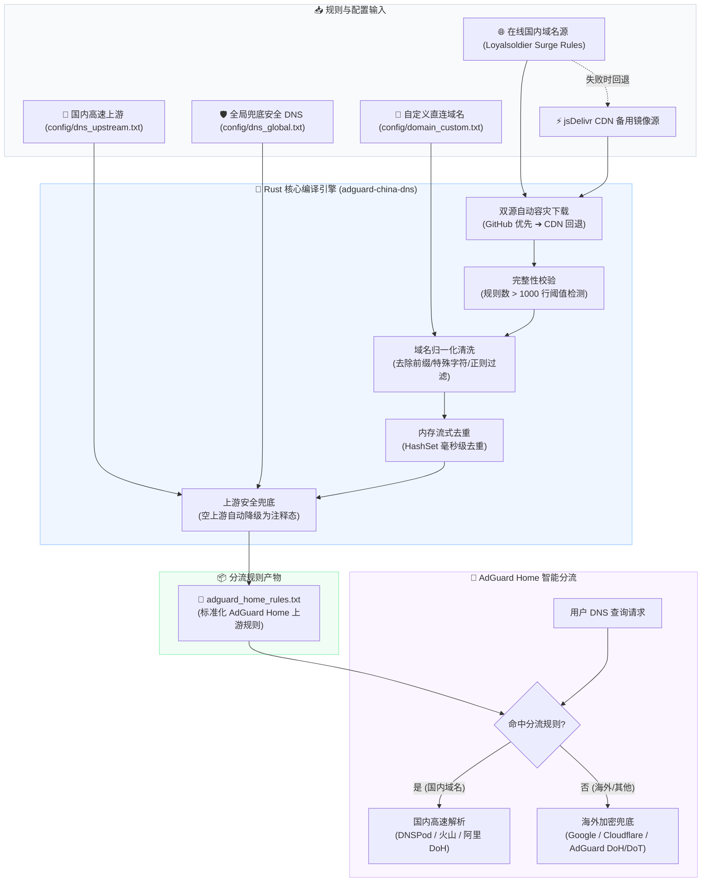

<div align="center">

# 🛡️ AdGuard Home DNS 分流规则编译工具

<p align="center">
  <strong>基于 Rust 打造的轻量、高性能国内外域名 DNS 分流规则清洗、聚合与自动化编译器</strong>
</p>

<p align="center">
  <a href="https://github.com/LianXia233/adguard-china-dns/releases/latest"></a>
  <a href="https://github.com/LianXia233/adguard-china-dns/actions/workflows/rust-release.yml"></a>
  <a href="Cargo.toml"></a>
  <a href="https://adguard.com/adguard-home.html"></a>
  <a href="LICENSE"></a>
  <a href="https://github.com/LianXia233/adguard-china-dns/stargazers"></a>
</p>

<p align="center">
  <a href="#features">✨ 核心特性</a> •
  <a href="#architecture">📊 架构设计</a> •
  <a href="#quick-start">🚀 快速上手</a> •
  <a href="#adguard-home">🔌 接入配置</a> •
  <a href="#config">⚙️ 配置说明</a> •
  <a href="#crontab">⏰ 定时更新</a> •
  <a href="#faq">❓ 常见问题</a>
</p>

---

</div>

> [!TIP]
> 💡 **无需本地安装环境**：本项目通过 GitHub Actions **每日北京时间 07:23 自动构建并发布**最新规则文件。大多数用户只需直接订阅或下载 [Releases](https://github.com/LianXia233/adguard-china-dns/releases/latest) 中的 `adguard_home_rules.txt` 即可！

---

## 📖 背景与痛点

在使用 AdGuard Home 搭建全屋或局域网 DNS 服务时，常常面临分流两难的问题：

- **全部走国内公共 DNS**：国内 CDN 识别精准、访问极速，但海外域名无法正常解析，且极易遭遇 DNS 污染；
- **全部走海外加密 DNS (DoH/DoT/DoQ)**：海外网站解析正常且具备防污染能力，但国内各大流媒体、应用商店和各大 CDN 节点会被调度至境外服务器，导致网络延迟骤增甚至卡顿。

本项目专为解决该痛点而开发：利用 **Rust 原生高性能引擎**，将经过清洗与去重的优质中国直连域名清单与高速上游 DNS 聚合，一键编译为 AdGuard Home 原生支持的 `upstream_dns_file` 分流规则文件：
- 🇨🇳 **国内域名**：经由优质国内 DNS（如 DNSPod DoH / 阿里 DoT / 火山引擎等）极速解析并调度至就近 CDN 节点；
- 🌐 **海外及未命中域名**：经由海外高安全性加密 DNS（如 Google DNS / Cloudflare DoH / AdGuard DNS）进行防污染兜底解析。

---

<a id="architecture"></a>
## 📊 工作流架构



---

<a id="features"></a>
## ✨ 核心特性

- ⚡ **极致性能与低资源占用**：基于 Rust 原生静态编译，内部采用 `HashSet` 域名归一化索引去重，编译数万条规则仅需数十毫秒，无 Shell 管道频繁 Fork 进程的性能开销。
- 🔄 **智能双源自动容灾**：在线规则下载默认优先采用 GitHub 原源直连，遇阻或超时秒级回退至 jsDelivr CDN 镜像，保障抓取高可用。
- 🛡️ **严格行数阈值校验**：抓取结果不足 1000 行立即触发告警并终止覆写，杜绝因上游源损坏或网络波动生成空白规则毁坏现有线上配置。
- 🔒 **空上游安全无缝降级**：当未配置 `dns_upstream.txt` 时，自动将所有域名转换为带 `#` 的注释态规则，平滑降级使用全局 DNS 解析，避免 AdGuard Home 语法报错。
- 📦 **零运行时系统依赖**：彻底摆脱传统脚本对 `bash`、`curl`、`awk`、`sed` 等系统工具链的依赖，单一静态二进制，即开即用。
- 🌐 **原生全平台兼容**：支持在 Linux（x86_64 / ARM64 / MIPS 等架构）、macOS 及 Windows 平台直接编译运行。
- 🤖 **全自动 CI/CD 云端构建**：依托 GitHub Actions 定时流水线，每日自动拉取、编译、清洗并发布最新规则 Releases。

### 📊 方案对比

| 对比维度 | 传统 Shell 脚本方案 | 本项目 Rust 编译引擎 |
| :--- | :--- | :--- |
| **运行时依赖** | 强依赖 Bash、cURL、Awk、Sed、Grep 等系统组件 | **零依赖**，单一静态编译二进制文件 |
| **网络容灾** | 单一源拉取，遇阻或断网直接报错中断 | **双源自动容灾**（GitHub 直连 ➔ jsDelivr CDN 镜像） |
| **脏数据防护** | 无法准确校验内容完整度，容易生成空规则 | **严格行数校验**（不足 1000 行拒绝覆写） |
| **去重与内存** | 管道多进程频繁 Fork 过滤，IO 与 CPU 开销高 | 内存流式处理，`HashSet` 极致毫秒级索引去重 |
| **容错机制** | 上游 DNS 为空时语法错乱可能引发服务崩溃 | **智能注释态降级**，规则完整保留且安全解析 |
| **跨平台性** | 局限于类 Unix 环境，Windows / 嵌入式难适配 | 跨平台支持 Linux (x86_64/ARM/MIPS)、macOS、Windows |

---

<a id="quick-start"></a>
## 🚀 快速上手

根据你的实际使用场景，选择以下任一方式即可：

### 方案 A：开箱即用 · 直接获取预编译规则（推荐 ⭐⭐⭐⭐⭐）

无需本地编译环境，直接下载 GitHub Actions 每日自动构建发布的最新规则文件：

```bash
# 下载最新编译的规则文件至 AdGuard Home 配置目录
wget -O /opt/adguardhome/conf/adguard_home_rules.txt \
  https://github.com/LianXia233/adguard-china-dns/releases/latest/download/adguard_home_rules.txt
```

> [!NOTE]
> 若服务器直连 GitHub 速度较慢，可使用加速镜像源下载：
> ```bash
> wget -O /opt/adguardhome/conf/adguard_home_rules.txt \
>   https://ghproxy.net/https://github.com/LianXia233/adguard-china-dns/releases/latest/download/adguard_home_rules.txt
> ```

---

<a id="crontab"></a>
### 方案 B：定时自动更新 · Crontab 自动化（推荐 ⭐⭐⭐⭐）

适合在 Linux 宿主机或部署了 AdGuard Home 的服务器上保持规则持续最新：

```bash
# 1. 打开 Crontab 编辑器
crontab -e

# 2. 添加每日凌晨 03:30 自动拉取最新规则并重载 AdGuard Home 容器
30 3 * * * wget -qO /opt/adguardhome/conf/adguard_home_rules.txt https://github.com/LianXia233/adguard-china-dns/releases/latest/download/adguard_home_rules.txt && docker restart adguardhome > /dev/null 2>&1
```

---

### 方案 C：本地源码编译 · 自定义私有规则

适合需要维护私有内网域名、自定义 DNS 清单或自行定制编译逻辑的高级用户：

#### 1. 源码编译

```bash
# 克隆源码并构建
git clone https://github.com/LianXia233/adguard-china-dns.git
cd adguard-china-dns
cargo build --release

# 安装二进制至系统 PATH
sudo cp target/release/adguard-china-dns /usr/local/bin/
```

#### 2. 初始化配置文件

首次在目标目录运行程序，若未检测到配置文件，将自动生成默认模板：

```bash
adguard-china-dns
```

#### 3. 环境变量参数配置

支持通过环境变量灵活指定输出目标和配置路径：

| 环境变量 | 默认值 | 说明 |
| :--- | :--- | :--- |
| `OUTPUT_FILE` | `$TMPDIR/adguard_home_rules.txt` 或 `/tmp/...` | 最终生成的分流规则输出文件路径 |
| `CONFIG_DIR` | 二进制程序同级目录下的 `config/` | 配置文件目录路径 |
| `TMPDIR` | `/tmp` | 临时文件存放目录 |

**自定义路径运行示例**：

```bash
CONFIG_DIR="/opt/adg-rule-compiler/config" \
OUTPUT_FILE="/opt/adguardhome/conf/adguard_home_rules.txt" \
adguard-china-dns
```

---

<a id="adguard-home"></a>
## 🔌 接入 AdGuard Home

### 步骤 1：放置规则文件
将生成的 `adguard_home_rules.txt` 规则文件保存至服务器指定路径（如 `/opt/adguardhome/conf/adguard_home_rules.txt`）。

### 步骤 2：修改 `AdGuardHome.yaml`
编辑 AdGuard Home 配置文件，在 `dns:` 配置段下引入规则文件路径：

```yaml
dns:
  # 指定分流规则文件路径
  upstream_dns_file: /opt/adguardhome/conf/adguard_home_rules.txt

  # 建议配置快速 Bootstrap DNS 用于解析 DoH 域名
  bootstrap_dns:
    - 223.5.5.5
    - 119.29.29.29
```

> [!WARNING]
> **Docker 部署特别注意**：
> 若使用 Docker 容器化运行 AdGuard Home，此处填写的路径必须是**容器内部视角的文件路径**，而非宿主机外部路径！
> - 例如宿主机映射参数为 `-v /opt/adguardhome/conf:/opt/adguardhome/conf`，则路径一致；
> - 若映射参数为 `-v /data/adg:/opt/adguardhome/conf`，则应填写 `/opt/adguardhome/conf/adguard_home_rules.txt`。

### 步骤 3：重载服务生效

```bash
# 宿主机 systemd 部署
sudo systemctl restart AdGuardHome

# Docker 容器化部署
docker restart adguardhome
```

### 步骤 4：验证分流生效

进入 AdGuard Home Web 控制台 ➔ **查询日志 (Query Log)**：
- 查询国内域名（如 `baidu.com`、`qq.com`）：上游服务器应显示为 `dns_upstream.txt` 中配置的高速国内 DNS；
- 查询海外域名（如 `github.com`、`cloudflare.com`）：上游服务器应显示为 `dns_global.txt` 中配置的安全加密 DNS。

---

<a id="config"></a>
## ⚙️ 配置文件说明 (`config/`)

按需编辑 `config/` 目录中的配置文件（每行一条记录，支持 `#` 开头的注释行）：

### 1. 全局 / 海外兜底 DNS (`config/dns_global.txt`)
未命中分流规则或国内上游失效时使用的解析服务器（支持 DoH、DoT、DoQ 及标准 IP）：

```text
https://dns64.dns.google/dns-query
https://208.67.222.222/dns-query
https://101.101.101.101/dns-query
tls://1.0.0.1
tls://1.1.1.1
quic://dns.adguard-dns.com
https://dns.google/dns-query
```

### 2. 国内加速 DNS (`config/dns_upstream.txt`)
命中分流规则库时采用的高速解析通道：

```text
https://sm2.doh.pub/dns-query
tls://dot.pub
https://doh.pub/dns-query
https://doh.volcengine.com/dns-query
tls://dot.volcengine.com
```

### 3. 本地与自定义直连域名 (`config/domain_custom.txt`)
最高优先级规则，强制经由国内上游直连解析。适合添加局域网设备、路由器后台或私有域名：

```text
# 局域网与路由器面板
router.asus.com
miwifi.com

# 本地私有服务与 NAS
my-nas.local
home.lan

# 个人直连域名
xoyo.com
calatopia.com
kurogames.com
wegame.com.cn
```

---

## 🤖 GitHub Actions 自动化流水线

仓库已预置 [`.github/workflows/rust-release.yml`](.github/workflows/rust-release.yml)，具备全托管云端自动化发布能力：

- **触发机制**：
  - ⏰ **定时调度**：每日 **UTC 23:23**（北京时间 **07:23**，避开 GitHub Actions 整点排队拥堵）
  - 🔄 **代码推送**：`src/**`、`Cargo.toml`、`config/**` 或流水线定义变更推送至 `main` 分支
  - 🖐️ **手动触发**：支持在 GitHub 仓库 Actions 控制台手动触发（`workflow_dispatch`）
- **执行流程**：
  1. 检出源码并构建高度裁剪的 Release 二进制产物
  2. 运行编译器生成全量规则文件 `adguard_home_rules.txt`
  3. 自动扫描并清理过往旧版 Release，保持仓库资产轻量整洁
  4. 创建带有时间戳的新 Release（格式如 `YYYY-MM-DD HH:MM 更新`），上传发布规则资产

---

<a id="faq"></a>
## ❓ 常见问题与技巧 (FAQ)

<details>
<summary><strong>Q: 为什么推荐使用 <code>upstream_dns_file</code> 而不是在 Web 界面添加数万条过滤规则？</strong></summary>

> **性能与资源消耗天差地别**：
> AdGuard Home 的“过滤器规则”主要用于广告拦截与重定向，加载数万条过滤规则会带来显著的内存与正则匹配开销；
> 而 `upstream_dns_file` 是 AdGuard Home 专为**上游分流调度**设计的核心机制，解析引擎以字典树极速哈希分流，加载数万条域名规则也能保持近乎零延迟。
</details>

<details>
<summary><strong>Q: 下载规则过程中网络超时或失败，会导致现存规则被破坏吗？</strong></summary>

> **完全不会**。
> 1. 本项目具备 GitHub 直连 ➔ jsDelivr CDN 双源容灾机制；
> 2. 内置严格的行数阈值保护（行数 < 1000 立即终止覆写）；
> 3. 若下载彻底失败，程序会直接报错退出，现有的规则文件不会被修改或清空，AdGuard Home 将持续正常工作。
</details>

<details>
<summary><strong>Q: 容器启动报错：<code>cannot load upstream rules from file: open ...: no such file or directory</code>？</strong></summary>

> 这通常发生在 **Docker 容器部署环境**。请确认：
> 1. 宿主机存放规则的目录是否已在 `docker run` 或 `docker-compose.yml` 中正确映射进容器；
> 2. `AdGuardHome.yaml` 中配置的路径是**容器内部的文件路径**，而非宿主机外部路径。
</details>

<details>
<summary><strong>Q: 生成的规则文件中域名与上游是什么对应关系？</strong></summary>

> 编译器会自动将配置的所有国内上游拼接在域名之后，形如：
> `[/example.com/]https://doh.pub/dns-query tls://dot.pub`
> AdGuard Home 在解析该域名时，会按照其配置的 `upstream_mode`（如并发查询或最快响应模式）同时向这些国内上游发起请求。
</details>

---

## 📂 目录结构

```text
adguard-china-dns/
├── .github/
│   └── workflows/
│       └── rust-release.yml      # GitHub Actions 自动化编译发布工作流
├── config/
│   ├── dns_global.txt            # 全局海外/兜底 DNS 服务器清单
│   ├── dns_upstream.txt          # 国内加速上游 DNS 服务器清单
│   └── domain_custom.txt         # 自定义直连/私有域名清单
├── src/
│   └── main.rs                   # 规则拉取、清洗与聚合核心引擎
├── Cargo.toml                    # Rust 工程与依赖规格配置
├── CHANGELOG.md                  # 版本迭代日志
├── LICENSE                       # 开源协议 (GPL-3.0)
└── README.md                     # 项目详细使用指南
```

---

## 📜 数据来源与开源协议

- **规则数据源**：在线分流规则源自 [Loyalsoldier/surge-rules](https://github.com/Loyalsoldier/surge-rules)，感谢其长期维护的优质网络规则资产。
- **开源协议**：本项目核心编译引擎采用 [GPL-3.0](LICENSE) 协议开源；各上游域名数据资产版权归原维护者所有。

<div align="center">

**如果这个项目对你有帮助，欢迎点一个 ⭐️ Star 给予支持！**

</div>
